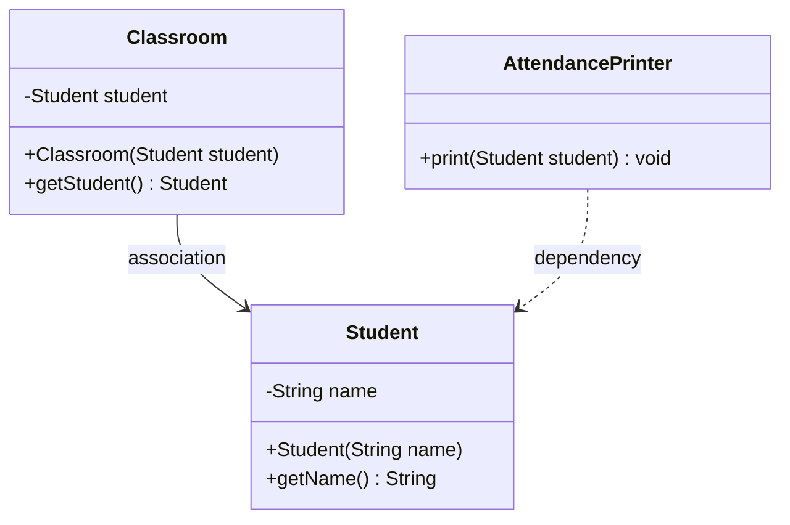

# 5. 클래스 다이어그램과 관계

실습 파일: [RelationshipDemo.java](../src/lesson/step05/RelationshipDemo.java)
각 예제 안의 static class는 파일 하나에서 예제를 실행하기 위한 중첩 클래스. 서로 다른 step의 Student는 별개 클래스임.

## 접근제한자

| Java | UML | 접근 범위 |
| --- | --- | --- |
| public | + | 어디서나, 단 클래스 자체도 접근 가능해야 함 |
| protected | # | 같은 패키지 + 다른 패키지의 하위 클래스에서 상속 규칙에 따라 |
| 제한자 생략(package-private, 흔히 default 접근) | ~ | 같은 패키지 |
| private | - | 선언한 클래스 내부 중심; 같은 최상위 클래스 안의 중첩 클래스에는 접근 규칙상 예외가 있음 |

다른 패키지에서 protected 멤버는 임의의 부모 객체를 통해 자유롭게 접근하는 것이 아님.
접근제한자를 생략하는 것과 인터페이스의 default 메서드는 다른 개념.

## Association과 Dependency

- Association(연관): 객체 사이의 구조적 연결. 예제의 Classroom이 Student를 필드로 보관.
- Dependency(의존): 다른 타입을 사용하므로 그 타입의 변경에 영향을 받음. AttendancePrinter가 메서드 매개변수로 Student를 사용.
- 필드/매개변수 구분은 이 예제를 이해하는 기준. 모든 모델링에서 선언 위치만으로 관계를 기계적으로 결정하지는 않음.
- 연관을 갖는 클래스도 넓은 의미에서는 상대 타입에 의존함.



## 실행
먼저 저장소 루트에서 build 스크립트 실행 후:
```text
java -cp out lesson.step05.RelationshipDemo
```
예상 출력:
```text
Classroom: KyungHo
Attendance: KyungHo
```

확인: print 호출이 끝난 뒤에도 Classroom은 Student 참조를 필드에 보관하는가?
추가 연습: IDE에서 별도의 최상위 클래스를 만들어 private 필드에 직접 접근할 때 컴파일 오류가 나는지 확인.
